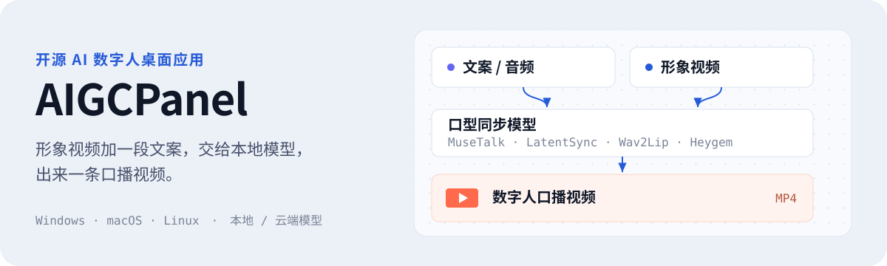
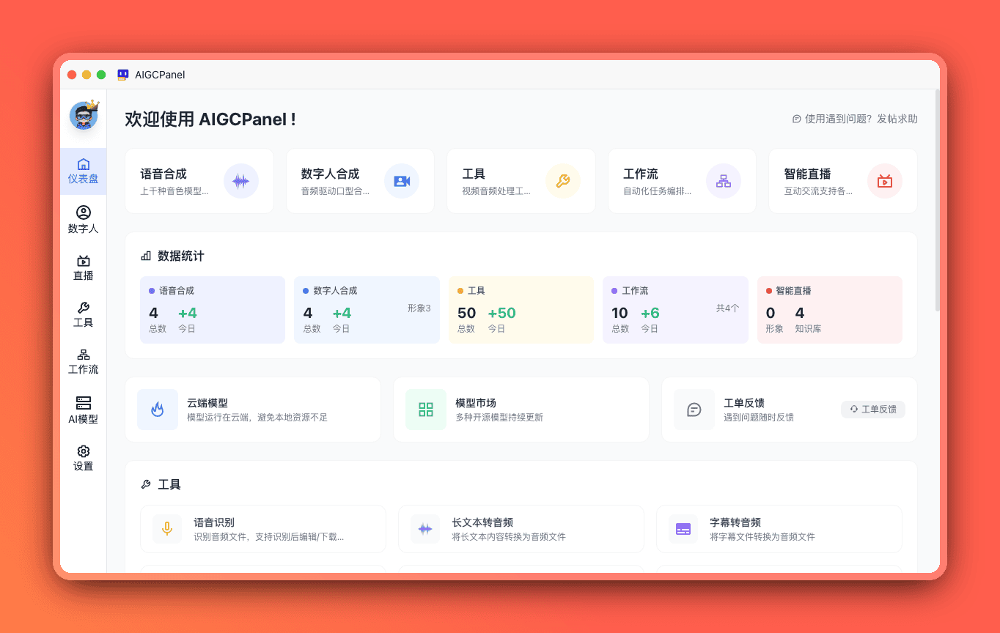
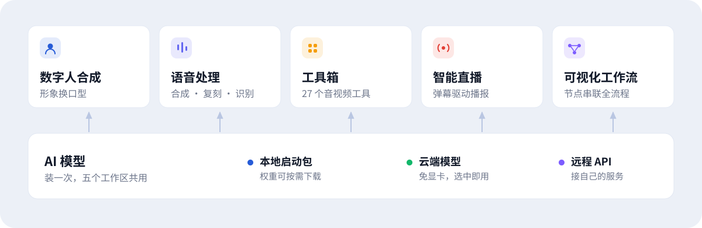
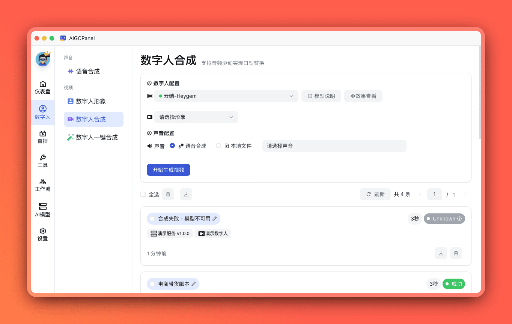
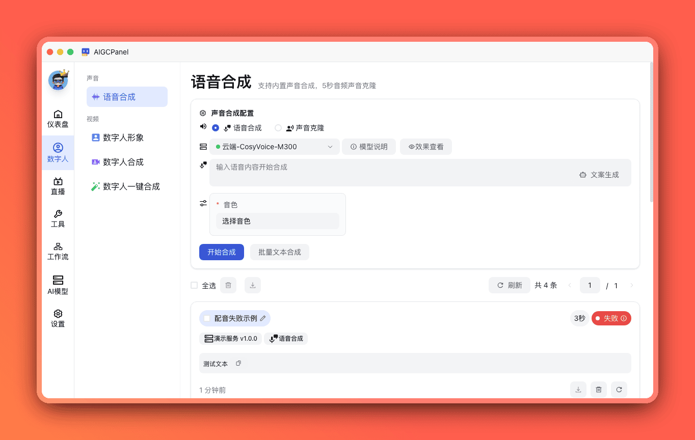
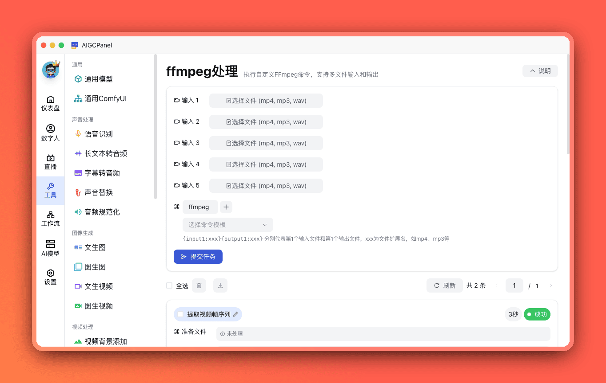
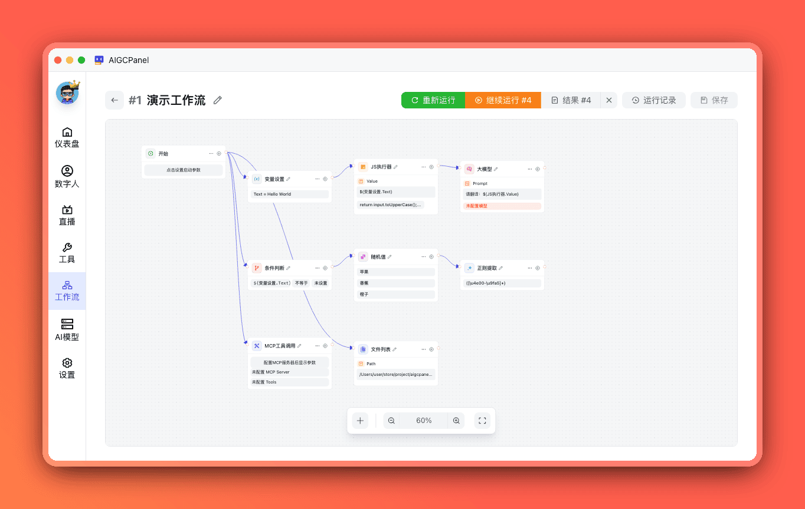
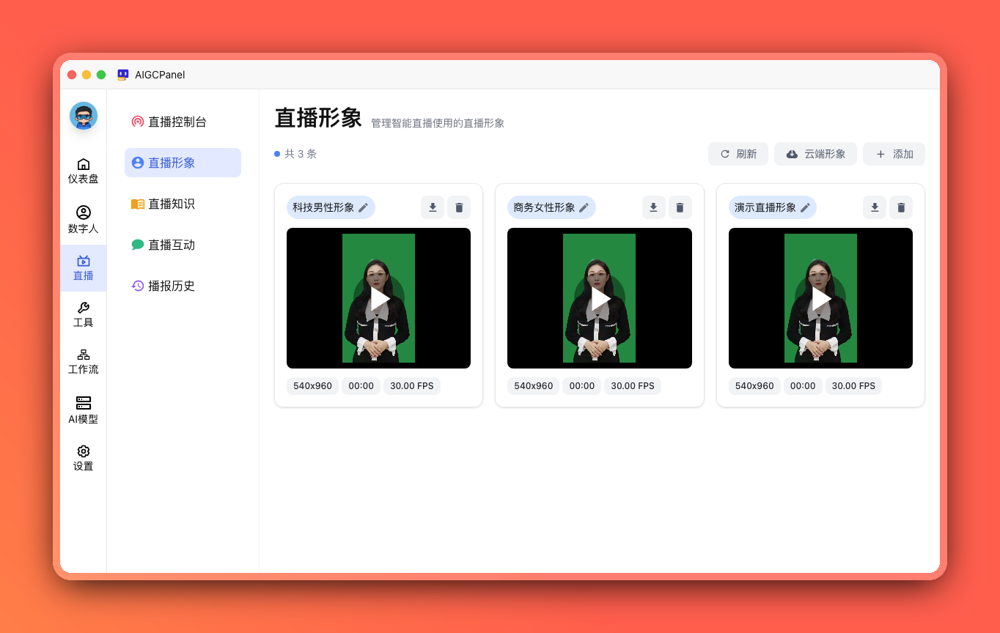
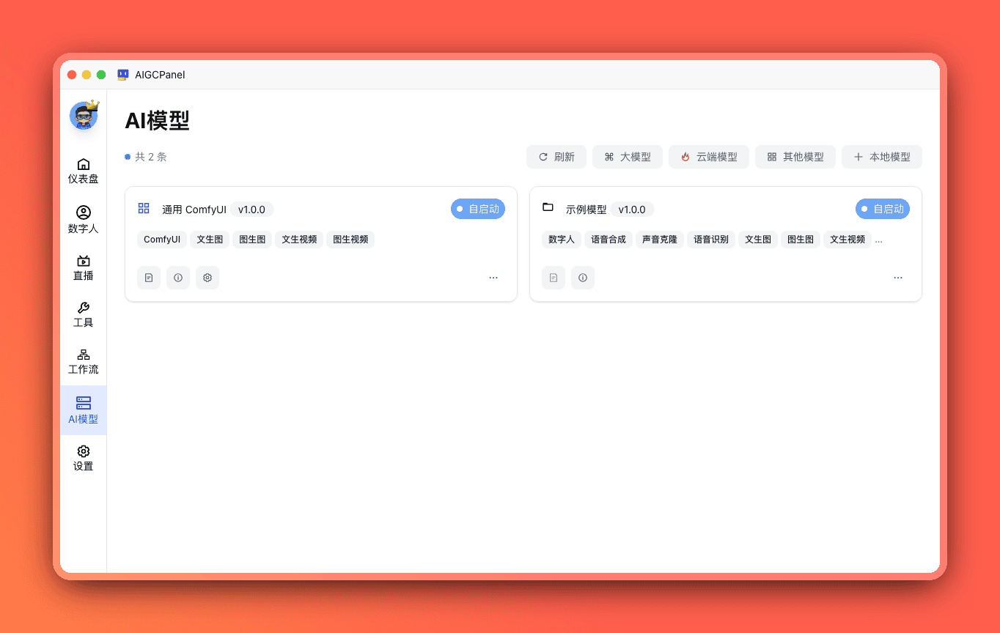

<p align="center">
  
</p>

<p align="center">
  <a href="https://aigcpanel.com"></a>
  
  
  
  <a href="https://github.com/modstart-lib/aigcpanel"></a>
  <a href="https://gitee.com/modstart-lib/aigcpanel"></a>
</p>

AIGCPanel 是一个装在自己电脑上的 AI 数字人工作台。模型由你下载到本机，口型合成、语音合成、语音识别、音视频处理都在本地跑；显卡不够用的时候，同一个界面里可以换成云端模型或者你自己的 API。

装好打开是这个样子：



出一条视频只要三步：

1. 打开「AI 模型」，下载一个模型启动包（想先用云端模型也行，不用等下载）
2. 进「数字人合成」，选形象，输入文案或上传音频
3. 生成完在任务列表里下载

## 五个工作区，一层模型



模型在「AI 模型」里装一次就够了，其他页面取的是同一份列表。工作流把口型合成、语音合成、工具箱里的工具都做成节点，前后还能接大模型、JS 脚本和文件操作。

## 界面

### 数字人合成

上传形象视频，或者给一张正脸照片，让它自己生成 5 秒形象视频。文案交给语音模型合成音轨，也可以直接上传音频。口型模型 MuseTalk、LatentSync、Wav2Lip、Heygem 可以换着比效果，形象模板在「我的形象」里管。



### 语音处理

七个 TTS 模型，语速和音调能调。参考音频给 6～20 秒，就能复刻一个音色，试听满意再保存。任务列表支持批量下载。



### 工具箱

27 个工具，分声音、生成、视频、通用四组。视频组最多，16 个：背景添加和绿幕替换、智能剪辑、片段放大、标注、字幕、整体和片段变速、尺寸转换、压缩、片段保留、片头片尾图片、添加音频、视频合并、格式转换，以及自定义 FFmpeg 命令。声音组有语音识别（带时间戳，可导出字幕）、长文本转音频、字幕转音频、声音替换和音频规范化；生成组是文生图、图生图、文生视频、图生视频；通用组接自定义模型和 ComfyUI 工作流。



### 可视化工作流（VIP）

画布上拖节点：大模型、JS 脚本、条件分支、MCP 工具调用、文件操作、变量、随机值、正则提取，还有工具箱里的每个工具。支持断点续跑，节点状态和运行历史直接标在画布上。



### 智能直播（VIP）

接抖音、哔哩哔哩、虎牙、斗鱼、快手的弹幕，命中知识库里的关键词就播语音或数字人视频；直播中手动打字，数字人也会念出来。语音直播和数字人直播两种形式，输出 RTMP 流，违禁词检测和回复 Prompt 可以自己配。

直播形象单独一页：绿幕视频、正脸自拍视频都收在这里，直播时按选中的那条出画。



### AI 模型

本地模型导入后能启动、停止、看日志、改参数；远程 API 和云端模型在同一个列表里。权重支持按需下载，不用一次拖几个 G。命令行 `aigcpanel` 调的也是这份列表。



## 支持模型

- **口型同步**：[MuseTalk](https://github.com/TMElyralab/MuseTalk) / [LatentSync](https://github.com/bytedance/LatentSync) / [Wav2Lip](https://github.com/Rudrabha/Wav2Lip) / [Heygem](https://github.com/duixcom/Duix.Heygem)
- **语音合成**：[CosyVoice-300M](https://github.com/FunAudioLLM/CosyVoice) / [CosyVoice-300M-Instruct](https://github.com/FunAudioLLM/CosyVoice) / [CosyVoice2-0.5b](https://github.com/FunAudioLLM/CosyVoice) / [FishSpeech](https://github.com/fishaudio/fish-speech) / [IndexTTS](https://github.com/index-tts/index-tts) / [SparkTTS](https://github.com/SparkAudio/Spark-TTS) / [GPT-SoVITS](https://github.com/RVC-Boss/GPT-SoVITS)
- **语音识别**：[FunASR](https://github.com/modelscope/FunASR)

上面这些是客户端内置支持的。模型市场里还有别的包，也可以自己导入。

## 安装

从 [aigcpanel.com](https://aigcpanel.com) 下载安装包。装完在「AI 模型」里下一个启动包就能开工；不想等下载，可以先选云端模型。

- **Windows**：`.exe` 双击安装
- **macOS**：`.dmg`，Intel 和 Apple Silicon 都有。首次打开如果提示来源未知，去「系统设置 → 隐私与安全性」点「仍要打开」
- **Linux**：提供 AppImage 和 deb 两种格式

```shell
chmod +x AIGCPanel.AppImage && ./AIGCPanel.AppImage
sudo dpkg -i AIGCPanel.deb
```

本地模型第一次启动要等你电脑把模型加载完，之后点启动就行。云端模型和远程 API 不吃本机显卡。界面内置简体中文和英语，支持暗色模式。

## 本地开发

Node.js 24 及以上。技术栈是 Electron + Vue 3 + TypeScript + Arco Design，本地数据存 SQLite，工作流画布用 LogicFlow。

```shell
npm install
npm run dev            # 开发模式
npm run build:preview  # 编译检查
npm run build          # 打包
```

## 命令行工具

`aigcpanel` 可以在终端里直接调模型，适合写进脚本。可在「设置 → 命令行工具」一键装到 PATH，也可以手动把 `dist-cli/` 下对应平台的可执行文件加进 PATH。

```shell
aigcpanel --help

# 有哪些模型服务
aigcpanel serverList

# 调用模型函数（文生图、语音合成、ComfyUI 工作流都可以）
aigcpanel serverCall --server server-demo|1.1.0 --function textToImage \
  --prompt "风景" --param '{"width":512,"height":512}'
aigcpanel serverCall --server server-ComfyUI|1.0.0 --function comfyui \
  --comfyuiName demo1 --param '{"width":512,"height":512}'

# 看日志、改参数、安装或删除模型
aigcpanel serverLog --server server-demo|1.1.0
aigcpanel serverSetting --server server-demo|1.1.0 --idleTimeout 120
aigcpanel serverInstall --dir /path/to/model-dir

# 调工具箱里的工具，参数统一走 --param
aigcpanel tools --name VideoCompress --param '{"file":"/path/to/video.mp4"}'
```

## 问题反馈

- 先在 [Issues](../../issues) 里搜一下有没有同样的问题
- 新 Issue 带上系统、软件版本和复现步骤
- 也可以进下面的交流群直接问

## 更新日志

见 [changelog.md](./changelog.md)。

## 交流群

> 添加时备注 AIGCPanel

<table width="100%">
    <thead>
        <tr>
            <th width="50%">微信交流群</th>
            <th>QQ 交流群</th>
        </tr>
    </thead>
    <tbody>
        <tr>
            <td>
                
            </td>
            <td>
                
            </td>
        </tr>
    </tbody>
</table>

## 声明

本产品仅用于合法内容创作。严禁将本产品用于任何违法违规业务，使用时须遵守中华人民共和国相关法律法规。

## License

[Apache-2.0](./LICENSE)。分发和修改时请保留版权与许可声明；软件「关于」页显示的是同一份协议。
